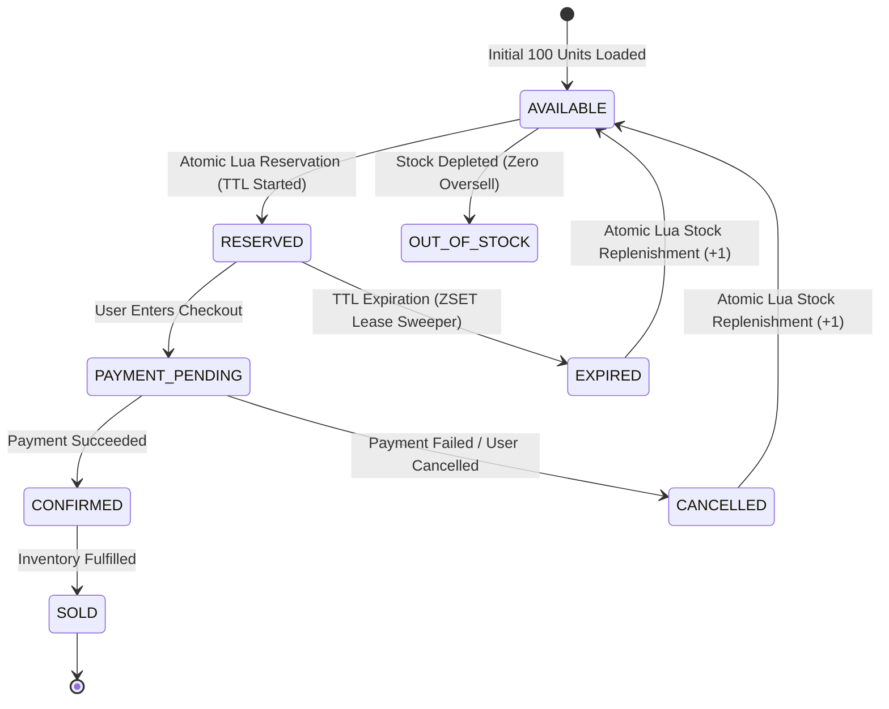

# High-Concurrency Flash Sale Inventory Architecture

## 1. Executive Summary & Design Rationale

Under high-velocity traffic spikes (e.g., **10,000 concurrent purchase requests** competing for **100 inventory units**), traditional relational database locking strategies (`SELECT ... FOR UPDATE` or Serialized Transactions) suffer catastrophic performance degradation:
- **Lock Contention**: 10,000 transactions queuing for the exact same database row lock cause thread starvation, query queue timeouts (504s), and high deadlocks.
- **Connection Pool Saturation**: Postgres connection poolers (e.g., max 50–100 connections) bottleneck immediately, causing severe client latency spikes.

### The Solution: Two-Tier Atomic Fast-Path + Write-Behind Durability
1. **Tier 1: Atomic In-Memory Concurrency Control (Redis Lua)**
   - Single-threaded event loop in Redis guarantees that Lua scripts execute **atomically** without race conditions.
   - 10,000 requests are evaluated in sub-millisecond in-memory operations.
   - 100 requests succeed; the remaining 9,900 requests fail fast (`OUT_OF_STOCK`) with 0 database load.
2. **Tier 2: Asynchronous Write-Behind Persistence (PostgreSQL)**
   - High-throughput reservations and audit records are persisted asynchronously and idempotently to PostgreSQL.
   - Non-blocking for the hot-path reservation endpoint.

---

## 2. Reservation State Machine & Lifecycle



### State Definitions:
1. **`AVAILABLE`**: Product stock counter is > 0 in the Redis pool.
2. **`RESERVED`**: User holds a temporary lease on 1 unit (15s TTL). Stock decremented by 1.
3. **`PAYMENT_PENDING`**: Checkout initiated; payment gateway processing.
4. **`CONFIRMED` / `SOLD`**: Payment succeeded. Lease permanently cleared, sold counter incremented.
5. **`EXPIRED` / `CANCELLED`**: Lease expired or payment failed. Stock counter incremented (+1) atomically.

---

## 3. Concurrency & Contention Mechanisms

### 3.1 Redis Data Structures
- **`inventory:product:{id}:stock`** (`String / Integer Counter`): Current available stock count.
- **`inventory:product:{id}:sold`** (`String / Integer Counter`): Confirmed sold units.
- **`reservation:{reservationId}`** (`JSON String with TTL`): Reservation metadata.
- **`reservation:leases`** (`Sorted Set (ZSET)`): `score = unix_timestamp_ms`, `member = reservationId`. Used for atomic lease sweeping.
- **`idempotency:{key}`** (`JSON String with TTL`): Cached response and operation status.

### 3.2 Atomic Lua Reservation Script (`reserve_inventory.lua`)
```lua
-- 1. Idempotency Check
local existing = redis.call('GET', KEYS[4])
if existing then
    return cjson.encode({ status = "IDEMPOTENT_HIT", data = cjson.decode(existing) })
end

-- 2. Stock Verification
local currentStock = tonumber(redis.call('GET', KEYS[1]) or '0')
local reqQuantity = tonumber(ARGV[1])
if currentStock < reqQuantity then
    return cjson.encode({ status = "OUT_OF_STOCK", availableStock = currentStock })
end

-- 3. Atomic Decrement
local remainingStock = redis.call('DECRBY', KEYS[1], reqQuantity)

-- 4. Store Reservation & Lease
redis.call('SETEX', KEYS[2], tonumber(ARGV[5]) + 300, reservationJson)
redis.call('ZADD', KEYS[3], tonumber(ARGV[6]), ARGV[2])

-- 5. Cache Idempotency Record
redis.call('SETEX', KEYS[4], tonumber(ARGV[5]) * 4, cjson.encode(responsePayload))
return cjson.encode(responsePayload)
```

---

## 4. Reservation Expiry & Zero-Loss Sweeper

Standard Redis keyspace notifications (`__keyevent@0__:expired`) are **fire-and-forget** (Pub/Sub). If the application server crashes or restarts, expired keys are lost, resulting in inventory leakage.

### Reliable Sorted Set (ZSET) Lease Pattern
1. Upon reservation, the `reservationId` is added to `reservation:leases` with `score = current_ms + ttl_ms`.
2. A background worker runs every 500ms executing `sweep_leases.lua`:
   - `ZRANGEBYSCORE reservation:leases -inf current_ms LIMIT 0 100`
   - For each expired item:
     * Atomically removes the lease from the ZSET (`ZREM`).
     * Transitions reservation state to `EXPIRED`.
     * Replenishes product stock counter (`INCRBY inventory:product:{id}:stock quantity`).
     * Asynchronously updates PostgreSQL `reservations` table and inserts audit record into `inventory_ledger`.

---

## 5. Idempotency Architecture

To prevent duplicate requests (e.g. from network retries, browser double-clicks, or malicious replay attacks):
1. Client supplies an `X-Idempotency-Key` (or generates a hash from `userId + productId`).
2. Fast-path lookup checks `idempotency:{key}` in Redis.
3. If already present:
   - Returns the cached response payload immediately with `status = 'IDEMPOTENT_HIT'`.
   - Bypasses stock decrement entirely.
4. Database Level: PostgreSQL `reservations.idempotency_key` carries a `UNIQUE` constraint, providing secondary defense against replay attacks.

---

## 6. Mathematical Invariant Verification

At any point in time during the flash sale, the following invariant **must strictly hold**:

$$\text{Initial Stock (100)} = \text{Available Stock} + \text{Active Reservations} + \text{Confirmed Sold}$$

The load-testing validation script checks and proves this invariant under 10,000 concurrent requests.
